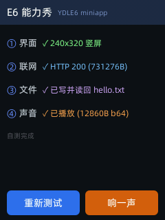
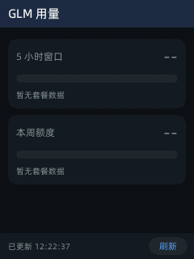
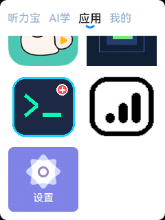
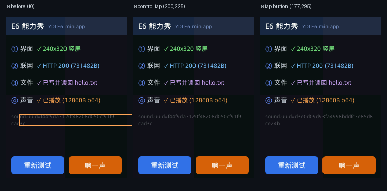

# 网易有道听力宝 E6 (YDLE6 / Rockchip RV1106) 玩机与自制开发指南

<p align="center">
  
</p>

<p align="center">
  <b>永久 Root 提权 · 永久免密 ADB + SSH · HTTP 远程调试 · 触摸注入 · Falcon 轻应用开发</b>
</p>

---

## 📖 项目简介

网易有道听力宝 E6（Model: YDLE6）搭载 **瑞芯微 Rockchip RV1106** 主控芯片（ARM Cortex-A7 32-bit，1.2GHz），配备 2.83 英寸 240×320 DPI LCD 屏幕、电容触摸屏，以及高达 **32GB Samsung eMMC 存储**。

官方固件基于 Linux 5.10 与定制的 QuickJS `miniapp` 图形引擎。本项目完整记录了：
1. **逆向分析与永久 Root 提权**：在 U-Boot 严格校验 Kernel RSA-2048 签名的情况下，通过 `rootfs_a` EROFS 镜像热补丁成功绕过 ADB 密码鉴权，取得永久最高 `root` 权限；
2. **Linux DRM/KMS 60FPS 原生图形开发**：无需 X11 / Wayland，基于 Linux 原生 DRM Dumb Buffer 与硬件换页（CRTC Flip），实现了 **真正无撕裂、无闪烁的 60FPS 平滑图形界面**；
3. **电容触摸屏防误触独占方案**：使用 Linux 内核 `EVIOCGRAB` 机制独占接管触摸屏，杜绝了返回桌面时的幽灵点击现象；
4. **原生桌面图标无缝集成**：无需替换或破坏原厂任何内置功能（如网易云音乐），通过轻应用包热注册在系统桌面上生成独立图标入口，点击即可唤醒自定义原生程序；
5. **永久免密 ADB + SSH**：借助固件自带的开机钩子（`S99_run_test_scripts` → `/userdisk/skip_re/skip_login.sh`）与 `mount --bind` 覆盖只读 rootfs 的鉴权脚本，**重启后 16 秒内自动恢复 SSH + 无线 ADB**，全程零口令、不用再碰屏幕上的调试开关；
6. **触摸注入与 HTTP 远程调试**：自研 ARM 注入器直写 `/dev/input/event3`（设备没有 `input`/`sendevent`），配套 HTTP 服务提供 **截图 / 点击 / 滑动 / 日志** 接口，并内置一个"点屏幕即注入触摸"的网页调试面板；
7. **Falcon 轻应用（MiniApp）开发**：破解官方字节码得出真实入口契约，跑通界面渲染 / HTTP 联网 / 文件读写 / 声音播放四大能力；
8. **GLM 用量查询 MiniApp**：桌面直接查看智谱 BigModel 套餐额度（5 小时窗口 / 本周 / 重置次数，多机构切换），HTTPS + 自定义请求头 + 纯 JS HMAC-SHA256 签名全部真机跑通。

---

## 🛠️ 硬件与系统信息

| 项目 | 参数 | 说明 |
| :--- | :--- | :--- |
| **主控芯片** | Rockchip RV1106 | ARM Cortex-A7 @ 1.2GHz，支持 NEON/VFPv4 |
| **系统架构** | Linux 5.10.160 (`armv7l`) | C 库为 uClibc-ng，极适合静态编译 |
| **内部存储** | 32GB Samsung eMMC | `/userdisk` 分区可用空间整整 **22.8 GB** |
| **屏幕规格** | 240 × 320 DPI RGB LCD | 驱动节点 `/dev/dri/card0` (Connector ID: 70, CRTC ID: 66) |
| **触摸芯片** | hyn_ts 电容触控 | 输入事件节点 `/dev/input/event3` |
| **调试接口** | USB-C ADB & Wi-Fi 无线调试 | 端口 5555 |
| **设备自带服务** | OpenSSH 8.8p1 / dropbear 2022.82 | 可直接开 SSH，无需编译 |

---

## 🔌 现在这台设备有 4 条可用通道

装完 [`tools/e6_ssh_setup.sh`](tools/e6_ssh_setup.sh) 后，**拔掉 USB 线、重启都照样能用**：

| 通道 | 端口 | 用途 | 状态 |
| :--- | :--- | :--- | :--- |
| **SSH** | 22 | root shell、装包、看系统 | 公钥登录，零口令 |
| **无线 ADB** | 5555 | 装 MiniApp、推文件、截图、脚本化 | 零口令 root |
| **HTTP 调试** | 8080 | 截图、点击、滑动、日志 + 网页面板 | 浏览器直接开 |
| 有道自带 WS | 9307 | —— | stub（任何 JSON 都回空），死路 |

四条通道**互不依赖**，每条都有看门狗兜底（掉了 30 秒内自动补）：

```bash
# SSH（自动按 MAC 找当前 IP，IP 变了也不用改配置）
~/bin/e6 'id'

# 无线 ADB
adb connect 192.168.0.201:5555

# HTTP 调试
curl http://192.168.0.201:8080/shot.png -o s.png
```

**为什么以前这么难搞**：有道固件把 USB 调试做成了「每次开机都要手动开」的开关
（设置 → 法律监管 → 连击文本 5 次），换 WiFi 后 `adb tcpip 5555` 也会失效；
而且本机 inittab 里**只有 `::respawn:-/bin/login`、没有 adbd 的 respawn**，
所以那条命令会让 adbd 自杀后没人再拉它，**USB 和 5555 会同时消失**，只能物理救回。
本项目用「固件自带开机钩子 + `mount --bind` 覆盖只读 rootfs 的鉴权脚本」把它彻底解决了。

---

## 📂 仓库目录结构

```text
youdao-tinglibao-e6/
├── README.md               # 项目主文档
├── docs/                   # 核心原理解析
│   ├── HARDWARE.md         # 硬件架构、引脚定义与 eMMC 分区表
│   ├── ROOT_GUIDE.md       # Root 提权与 EROFS 哈希热补丁全教程
│   ├── MINIAPP_DEV.md      # Falcon 轻应用开发完全指南（入口契约/四大能力）
│   ├── GLM_USAGE.md        # GLM 用量查询 MiniApp（智谱套餐额度看板）
│   ├── SCREENSHOT_AND_INPUT.md  # 真机截图与触摸注入（点击界面）完全指南
│   ├── PERSISTENT_ACCESS.md     # 永久免密 ADB + SSH（重启后自动恢复）
│   └── REMOTE_DEBUG.md          # HTTP 远程调试接口（截图/点击/日志）
├── miniapp/                # Falcon 轻应用（.amr）开发套件
│   ├── build_miniapp.sh    # 一键构建 → 部署 → 启动 → 抓屏取证
│   ├── e6_demo_app/        # 四合一能力演示应用（界面/联网/文件/声音）
│   └── host_tools/         # QuickJS 编译器 + .amr 打包器
├── src/                    # 原生自制程序源码
│   ├── hello_screen/       # 60FPS DRM 无闪烁双缓冲图形程序 (Go 实现)
│   ├── launcher_watcher/   # 原生桌面应用点击事件捕获与唤醒守护进程
│   ├── tap/                # e6_tap：触摸屏注入器（点击/滑动/长按）
│   ├── e6_debug_server/    # HTTP 远程调试服务（截图/点击/日志 + 网页面板）
│   └── web_server/         # 极轻量级板载 Web 文件/管理服务器
├── custom_app/             # 桌面自制应用模板 (独立 AppID 注册包与图标)
│   ├── manifest.json       # 轻应用元数据与 SHA/MD5 校验
│   └── app_icon.png        # 桌面图标文件 (102x94)
└── tools/                  # 常用开发脚本
    ├── build_all.sh        # 一键交叉编译所有组件
    ├── connect_wifi.sh     # Wi-Fi ADB 无线连接（自动找设备 IP）
    ├── push_and_run.sh     # 一键推送 ARM 二进制到设备运行
    ├── e6_device.sh        # 自动解析 ADB 目标（USB 优先，否则按 MAC 找 IP）
    ├── e6_ui.sh            # 界面自动化：截图/点击/滑动/长按/日志/diff
    ├── e6_ssh_setup.sh     # 一键装好「永久免密 ADB + SSH」
    ├── glm_usage_setup.sh  # GLM 用量 App 配置下发（API Key + JWT/org）
    ├── e6_device_scripts/  # 部署到设备上的脚本（鉴权/sshd/adbd/开机钩子）
    ├── adb_root.sh         # 以 root 执行命令（自动完成 adbd 认证）
    ├── usb_to_wifi.sh      # 插 USB 后一键切到无线 ADB
    └── pngdiff.py          # 像素级 A/B diff（判定操作是否真的生效）
```

### 📦 `miniapp/` —— Falcon 轻应用（`.amr`）开发套件

这是**设备原生支持**的应用形态：官方 launcher、网易云音乐、百度网盘
全都是 Falcon MiniApp（QuickJS + Vue 风格组件 + Yoga Flexbox + Skia 2D）。

```text
miniapp/
├── build_miniapp.sh       # 一键：编译 → 部署 → 启动 → 抓屏 → 打印日志
├── e6_demo_app/           # 四合一能力演示应用（界面/联网/文件/声音）
│   ├── app.js             #   入口：App 类 + 页面基类注册 + 页面加载器
│   ├── index.js           #   根页面组件
│   ├── manifest.json      #   应用清单 + MD5 签名表
│   ├── app_icon.png       #   桌面图标
│   └── assets/beep.wav    #   应用自带音频
├── glm_usage_app/         # GLM 用量查询（智谱套餐额度看板，见 docs/GLM_USAGE.md）
│   ├── index.js           #   全部逻辑：纯 JS HMAC-SHA256 + 接口 + 界面
│   └── app_icon.png       #   桌面图标（与墨水屏版同图）
├── host_tools/            # 构建工具链
│   ├── qjsc               #   QuickJS 编译器（macOS arm64）
│   ├── build_amr.py       #   .amr 打包器（自动签名 + adb 部署）
│   └── compile_js_bin.py
└── build/                 # 构建产物（.amr）
```

一键跑起来：

```bash
cd miniapp && ./build_miniapp.sh
```

<p align="center">
  
</p>

> 上图是真机截图：启动即自动自测 **界面渲染 / HTTP 联网 / 文件读写 / 声音播放**
> 四项能力，状态实时显示在屏幕上（240×320 竖屏）。

> **完整开发指南见 [`docs/MINIAPP_DEV.md`](docs/MINIAPP_DEV.md)** ——
> 含入口契约（`App()` 为什么不能用）、四大能力的可用 API 形状、
> E6 模块清单、样式白名单等，全部真机实测 + 官方字节码反汇编双重验证。

### 📊 第一个实战 MiniApp：GLM 用量查询

桌面图标点开即用 —— 查智谱 BigModel 套餐的 **5 小时窗口 / 本周额度**
用量百分比、进度条、重置时间、重置次数，多机构/项目胶囊一键切换，
60 秒自动刷新。与 Metalio 墨水屏版、Kindle 版同源接口契约（第三块屏）：

```bash
# 1. 构建 + 部署 + 启动 + 截图取证（一键）
cd miniapp && ./build_miniapp.sh glm_usage_app

# 2. 下发配置（Key 只进设备 600 权限文件，不进应用包/仓库）
cd .. && ./tools/glm_usage_setup.sh --api-key 'xxxx.yyyy' [--jwt '一次性网页JWT']
```

<p align="center">
  
  &nbsp;&nbsp;
  
</p>

> 技术要点：E6 的 `http` 模块支持 HTTPS + 自定义请求头（真机实证）；
> BigModel 要的短时效 HS256 JWT 用 **纯 JS SHA-256/HMAC** 现算
> （设备无 openssl/base64 命令，签名已与 Node crypto 对拍验证）。
> 完整文档见 [`docs/GLM_USAGE.md`](docs/GLM_USAGE.md)。

---

## 🖱️ 界面自动化：截图与点击

听力宝没有 `input` / `sendevent` 命令，所以 `adb shell input tap` 是一条**空操作**
（返回 0，却什么也没发生）。本仓库提供两条**真机实测可用**的路径：

```bash
# 截图（官方 miniapp_cli，240×320 PNG）
./tools/e6_ui.sh shot out.png

# 点击 / 滑动 / 长按（自研 e6_tap，直接写 /dev/input/event3）
./tools/e6_ui.sh tap   177 295
./tools/e6_ui.sh swipe 200 60 40 240
./tools/e6_ui.sh long  60 200 800

# A/B 判定：画面到底变了没有（差异像素为 0 = 操作没生效）
./tools/e6_ui.sh verify before.png after.png
```

<p align="center">
  
</p>

> 上图左→右：**①** 初始画面 → **②** 点中性空白区（对照组，MD5 与 ① 完全一致）
> → **③** 点「响一声」按钮，927 个像素发生变化，橙框标出即变化区域。

触摸坐标与 240×320 逻辑坐标 **1:1 对应**（无旋转无偏移），
所以**在截图上量到的像素坐标可以直接拿去点击**。

> 想在浏览器里直接点屏幕，用 [`docs/REMOTE_DEBUG.md`](docs/REMOTE_DEBUG.md) 里的
> **HTTP 调试面板**（8080 端口），或者：

```bash
# 或者走 HTTP 接口（不用 SSH / ADB）
curl "http://192.168.0.201:8080/tap?x=177&y=295"
```

> **完整指南见 [`docs/SCREENSHOT_AND_INPUT.md`](docs/SCREENSHOT_AND_INPUT.md)** ——
> 含坐标系统实测依据、内核事件流抓包证据、"同坐标连点事件流里没有 X/Y" 的成因、
> 以及黑屏判别（318 字节纯黑 PNG）等全部踩坑记录。

---

## 🔐 永久免密 ADB + SSH

有道固件把 USB 调试做成了**每次开机都要手动开**的开关（设置 → 法律监管 → 连击文本 5 次），
换 WiFi 后 `adb tcpip 5555` 也会失效。这个项目把它彻底解决了：

```bash
./tools/e6_ssh_setup.sh          # 一键安装
```

之后**重启也会自动恢复** —— 实测设备重启后 **16 秒** SSH(22) 与 ADB(5555) 一起就位：

```bash
ssh -i ~/.ssh/e6_ed25519 root@192.168.0.201     # SSH 公钥登录
adb connect 192.168.0.201:5555                  # 无线 ADB，零口令
```

原理（都不需要重刷固件、不碰 boot 分区的 RSA 签名）：

- 固件的 `/etc/init.d/S99_run_test_scripts` 会执行 `/userdisk/skip_re/skip_login.sh`
  —— 这就是**开机自启的落点**（`/userdisk` 是 ext4 持久分区）；
- rootfs 是 EROFS 只读，但 `mount --bind` 可以运行时覆盖 `/usr/bin/adbd_auth.sh`
  —— 换成恒成功版本，**ADB 永久免密**；
- adbd 由厂商的 `/etc/profile.d/adbd_tcp_port.sh` 固定 `ADB_TCP_PORT=5555`，
  由钩子按正确环境变量直接拉起（**不能用 `adb tcpip`** —— 本机 inittab 没有 adbd 的 respawn，
  那样会让设备彻底失联）；
- 设备自带 OpenSSH 8.8p1 和 dropbear 2022.82，主机密钥也现成，
  把 `AuthorizedKeysFile` 指到可写分区即可用公钥登录。

> **完整指南见 [`docs/PERSISTENT_ACCESS.md`](docs/PERSISTENT_ACCESS.md)** ——
> 含 bind-mount 原理、开机钩子源码、重启验证记录、卸载方法，
> 以及这台机器上 8 个会让脚本静默出错的怪癖（退出码不透传、stdin 转发挂死、没有 pgrep ……）。

---

## 🌐 HTTP 远程调试接口

不想插线、也不想开 SSH 的时候，浏览器直接开 **[`http://<ip>:8080/`](docs/REMOTE_DEBUG.md)**：

- 左边是**实时屏幕**（1.5 秒自动刷新），**点画面任意位置 = 给设备注入一次点击**；
- 右边有设备状态、日志面板（app / sound / error）、手动点击/长按/滑动；
- 也提供纯 API：`/shot.png`、`/tap?x=&y=`、`/swipe`、`/long`、`/logs`、`/status`。

```bash
curl http://192.168.0.201:8080/shot.png -o shot.png
curl "http://192.168.0.201:8080/tap?x=177&y=295"
```

<p align="center">
  
</p>

> 上图是通过 `GET /shot.png` 实时抓到的设备屏幕（18969 字节，正常渲染）。
> 顺带记住一个判据：**PNG 恰好 318 字节 = 纯黑 = app 没渲染**，不是抓屏失败。

服务由开机钩子拉起、看门狗守护，重启后自动恢复。

> **完整文档见 [`docs/REMOTE_DEBUG.md`](docs/REMOTE_DEBUG.md)** ——
> 含接口清单、实现要点、可选 token 鉴权、以及三条通道（HTTP / SSH / ADB）怎么选。
> ⚠️ 这个服务能注入任意触摸，等于**完整的远程输入控制** —— 公网或公共 WiFi 下务必开 token。

---

## 🚀 快速上手

### 0. 一键装好远程访问（推荐先做这个）

```bash
git clone https://github.com/weibaohui/youdao-tinglibao-e6.git
cd youdao-tinglibao-e6
./tools/e6_ssh_setup.sh
```

这一步会：

- 生成/复用 SSH 密钥，把公钥写进设备；
- 部署免密 ADB 鉴权脚本、sshd 配置、adbd 启动脚本、看门狗、开机钩子；
- 编译并部署 HTTP 调试服务与触摸注入器；
- **立即生效**，且重启后自动恢复。

装完就能用：

```bash
ssh -i ~/.ssh/e6_ed25519 root@192.168.0.201   # SSH
adb connect 192.168.0.201:5555                # 无线 ADB
open http://192.168.0.201:8080/               # 调试面板
```

> 需要设备已经能通过 ADB 拿到 root shell（见 [`docs/ROOT_GUIDE.md`](docs/ROOT_GUIDE.md)）。
> 如果设备还没 root，先插 USB 走一次提权流程。

### 1. 编译全套原生组件 (使用 Go 交叉编译)

Go 语言天然自带跨平台交叉编译支持，无需在宿主机安装复杂的 GCC 工具链：

```bash
# 进入 tools 目录并一键编译：
bash tools/build_all.sh
```

编译产物会自动生成在各源码目录下（均为纯静态 ARMv7 二进制）。

### 2. 连接听力宝

设备与电脑在同一局域网即可。**推荐用自动解析**（USB 优先，否则按 MAC 找当前 IP）：

```bash
source tools/e6_device.sh
D="$(e6_resolve_device)"          # → 192.168.0.201:5555 或 LE62200008802358
adb connect "$D"
```

或者直接用无线连接脚本（连不上时它会打印可执行的排查步骤）：

```bash
bash tools/connect_wifi.sh
```

> E6 的 IP 会随 DHCP 变化（实测 `192.168.0.109` → `192.168.0.201`），
> WiFi MAC `64:82:14:fb:c1:13` 才是恒定的。脚本按 MAC 跟随，不用改配置。

### 3. 一键推送并运行 60FPS 屏幕演示

```bash
bash tools/push_and_run.sh src/hello_screen/hello_screen
```

### 4. 编译并安装 Falcon 轻应用（MiniApp）

听力宝的系统应用本身就是 Falcon MiniApp，用同样的方式给它装一个自己的：

```bash
cd miniapp && ./build_miniapp.sh
```

脚本会自动完成：QuickJS 编译 → 打包 `.amr` → ADB 推送 →
`miniapp_cli install` → `miniapp_cli start` → 抓屏取证 → 打印应用日志。

装完在桌面就能看到「E6 能力秀」图标，点开是一个实时自测页：
界面渲染、HTTP 联网、文件写入、声音播放四项能力逐项显示结果。

### 5. 调试界面：截图 + 点击

```bash
./tools/e6_ui.sh shot out.png          # 截图
./tools/e6_ui.sh tap   177 295         # 点击
./tools/e6_ui.sh verify a.png b.png    # A/B 判定：画面变了没有
```

---

## 💡 核心图形技术与突破点

### 1. 彻底解决屏幕刷新跳动与闪烁 (Hardware Double Buffering)
- 初代 Demo 采用单显存缓冲直接写像素，由于 DPI LCD 扫描并发执行，肉眼能看到每帧逐像素被擦除又重画的跳变；
- **优化方案**：在 DRM 层开辟两个 Dumb Buffer（`buf0` 与 `buf1`），后台离屏渲染，绘制完成后调用 `DRM_IOCTL_SET_CRTC` 瞬间硬件换页；静态底色与卡片仅在内存中预渲染一次，达成稳定 60 FPS 丝滑运动！

### 2. 独占触摸解决退出时的“幽灵点击” (`EVIOCGRAB`)
- 当挂起 `miniapp` 运行自制图形界面时，若直接使用触摸退出，手指抬起时产生的触摸事件会残留在 Linux 输入子系统的消息队列中；
- 当恢复 `miniapp` 时，桌面会立即读取该残留点击，误开下层的其他应用；
- **优化方案**：在 `hello_screen` 中对 `/dev/input/event3` 发送 `ioctl(fd, EVIOCGRAB, 1)`。独占接管后，内核不再向其他任何应用派发触摸事件；退出时等待指尖抬起再释放独占，彻底杜绝误触。

---

## ⚠️ 免责声明与安全警告

1. 本项目仅供嵌入式 Linux 技术学习与个人折腾研究，请勿用于非法用途；
2. 听力宝的 `boot_a` 分区受 RSA-2048 严格签名保护，**千万不要直接烧写修改过的 boot 镜像**，否则将导致签名失效变砖；
3. 进行任何底层写块操作前，强烈建议使用 `dd` 对设备完整分区进行离线备份；
4. **本仓库的「永久免密 ADB + SSH」方案不触碰任何分区写入**：只用到固件自带的
   `/userdisk`（可写 ext4）和运行时的 `mount --bind` 覆盖，覆盖是**进程级、可逆的**，
   一条 `umount /usr/bin/adbd_auth.sh` 就能还原；
5. 免密 ADB + 公钥 SSH + 可注入触摸的 HTTP 服务等于**把设备完全交出去了**。
   设备一旦接入公共网络，务必：给 HTTP 服务设 `E6_TOKEN`、限制 SSH 来源、
   并把设备的 WiFi 密码改掉。

---

## 📄 开源许可证

本项目基于 [MIT License](LICENSE) 开源。欢迎大家提 Issue 和 PR，一起将有道听力宝 E6 打造成超便携的 Linux 墨水屏/小屏极客玩具！
