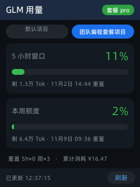
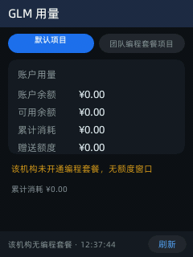

# GLM 用量查询（MiniApp · AppID 8090906000000002）

在听力宝 E6 的 240×320 屏幕上查看智谱 BigModel 套餐额度：
**5 小时窗口 / 本周额度** 的用量百分比、进度条、重置时间与剩余 Tokens，
**多机构/项目一键切换**。与 Metalio E-Ink4 墨水屏版、Kindle 版
（`kindle-koreader-app`）同源的接口契约 —— 这是第三块屏。

<p align="center">
  
  &nbsp;&nbsp;
  
</p>

> 左：**团队编程套餐**机构（`projectType=2`）—— 两个额度窗口 + 重置券 + 累计消耗。
> 右：**个人**机构（`projectType=1`）—— 该机构没买编程套餐，自动降级成账户余额/消耗视图。
> 顶部两个胶囊就是账号下的两个机构，点一下就切。

---

## 界面

- 顶部标题栏：应用名 + 套餐等级标签（接口返回 `level` 时显示，如 `pro`）
- 上下文胶囊行（多机构/项目时出现）：点击切换，选中项蓝底白字，**当前选中项写盘持久化**
- 套餐机构 → 两张卡片：
  - **5 小时窗口**：百分比大字 + 进度条（绿→黄→红 分档）+ 剩余 Tokens + 重置时间
  - **本周额度**：同构
- 无套餐机构 → 一张「账户用量」卡（余额 / 可用余额 / 累计消耗 / 赠送额度）+ 橙色提示
- 元信息行：MCP 请求次数、5h/周重置剩余次数、累计消耗（有则显示）
- 底部状态栏：更新时间 / 错误原因 + 「刷新」按钮
- 每 60 秒自动刷新一次

---

## 接口契约（Mac + E6 真机双向验证，2026-11-02）

| 用途 | 端点 | 鉴权 | 实测 |
| :--- | :--- | :--- | :--- |
| 发现机构/项目 | `GET https://bigmodel.cn/api/biz/customer/getCustomerInfo` | `Authorization: Bearer <网页端JWT>` | 200 → `data.organizations[]`，每项含 `projects[]` |
| 查额度 | `GET https://open.bigmodel.cn/api/monitor/usage/quota/limit?type=2` | API JWT + `Bigmodel-Organization` + `Bigmodel-Project` | 200 → `data.limits[]` + `data.level` |
| 查重置券 | `GET https://open.bigmodel.cn/api/biz/customer-package-reset/list?targetType=TEAM` | 同上 | 200 → `fiveHourResets[]` / `weekResets[]` |
| 团队账户消耗 | `GET https://open.bigmodel.cn/api/biz/account/query-org-owner-account-report` | 同上 | 200 → `balance` / `giveAmount` / `totalSpendAmount` |
| 个人账户消耗 | `GET https://open.bigmodel.cn/api/biz/account/query-customer-account-report` | 同上 | 200 → 同上字段 |

### 三个必须记住的坑

1. **API Key 和网页端 JWT 是两套东西，不能互换**
   - 额度/账户类接口只认 **API Key 现算的 HS256 JWT**；
   - `getCustomerInfo`（发现机构）**只认网页端 JWT**，
     拿 API JWT 去打会返回 `JWTToken not allow access`；
   - 拿 API Key 原文当 `Authorization` 也不行：`APIKey not allow access`。

2. **额度接口必须带机构/项目头**
   不带 `Bigmodel-Organization` + `Bigmodel-Project` 时接口返回 **HTTP 200 但 `data:{}`**（静默空数据），
   看起来像"没套餐"，其实是没定位到上下文。
   带对了同一个账号的团队机构才会返回 `limits[]`。

3. **个人机构没有 coding plan 是正常的**
   `quota/limit` 会返回 code 500「当前用户不存在coding plan」——
   这**不是错误**，App 会降级成账户余额/消耗视图并给出橙色提示。
   团队机构（`projectType=2`）才会返回额度窗口。

### 请求头格式

```http
Authorization: <由 <id>.<secret> 现算的 HS256 JWT>
Bigmodel-Organization: org-xxxxxxxxxxxxxxxx
Bigmodel-Project: proj_xxxxxxxxxxxxxxxx
Accept: application/json
```

额度接口要的 `Authorization` **不是 API Key 本身**，而是由 `<id>.<secret>`
现算的短时效 HS256 JWT（`{"api_key","exp","timestamp"}` 声明，1 小时有效期），
与墨水屏 / Kindle 版同一套签名逻辑。`x-coding-plan: true` 实测**不需要**。

E6 上没有 openssl/base64 命令、crypto 模块也只有 `md5sum`，
所以 `index.js` 内置了一套**纯 JS 的 SHA-256 + HMAC-SHA256 + base64url**。
正确性用 Node `crypto` 逐字节对拍保证：

```bash
node tools/glm_crypto_selftest.mjs
# 向量用例 16 条，失败 0 条
# JWT 端到端对拍：一致 ✓
```

覆盖填充边界（55/56/63/64/65 字节）、密钥长度边界、UTF-8 多字节与**代理对**。
> 对拍过程中真抓到过一个 bug：原 `strBytes()` 把代理对（emoji）编成了 6 字节而不是 4 字节，
> 已修（`index.js` 的 `strBytes`）。本 App 的 JWT 输入全是 ASCII，但工具函数不该带这个雷。

### 响应解析要点（与墨水屏版一致）

- `limits[]` 里 `TOKENS_LIMIT`/`CREDIT_LIMIT` 是两个窗口，
  **`nextResetTime` 更早的那个是 5 小时窗**，另一个是周窗；
- `TIME_LIMIT` 是 MCP 请求次数（`currentValue`/`usage`）；
- `percentage` 为已用百分比，`remaining` 为剩余 Tokens；
- 重置次数取 `fiveHourResets`/`weekResets` 里 `available != false` 的计数；
- 重置时间按 **UTC+8** 展示（额度控制台面向中国区）。

---

## 配置（本机不落 Key 进应用包）

配置放设备 `/userdisk/glm_usage/config.json`（权限 600），
由 [`tools/glm_usage_setup.sh`](../tools/glm_usage_setup.sh) 下发：

```bash
# ① 手工下发多个机构/项目（推荐：JWT 会过期，手填一次管半年）
./tools/glm_usage_setup.sh --api-key 'xxxxxxxx.yyyyyyyy' \
    --ctx '团队编程套餐项目|org-XXXX|proj-YYYY|2' \
    --ctx '默认项目|org-ZZZZ|proj-WWWW|1'

# ② 用一次性网页 JWT 自动发现账号下全部机构/项目
./tools/glm_usage_setup.sh --api-key 'xxxxxxxx.yyyyyyyy' --jwt 'eyJhbGci...'

# ③ 只配 API Key（个人版套餐 / 默认上下文够用）
./tools/glm_usage_setup.sh --api-key 'xxxxxxxx.yyyyyyyy'
```

`--ctx` 字段格式：`名称 | organizationId | projectId | projectType`，
`projectType` 可选（`1`=个人、`2`=团队编程套餐，影响账户口径选择，默认选中团队那个）。

四条上下文获取路径（按优先级）：

1. **`--ctx`（推荐）**：直接把机构/项目写进 `/userdisk/glm_usage/state.json`，
   App 启动即用，**不依赖任何会过期的 Token**。
   抓法：浏览器登录 [bigmodel.cn](https://bigmodel.cn) → F12 → Network →
   `getCustomerInfo` 响应里的 `data.organizations[].organizationId` 与
   `projects[].projectId`。
2. **`--jwt`（一次性）**：`Authorization: Bearer` 后面的整串。
   App 发现成功后自动把全部机构/项目存进 `state.json`，并**从配置里清除 JWT**
   （与墨水屏版同一策略，Token 不落盘复用）。
3. **`--org` + `--project`**：从 DevTools 里直接抓 `Bigmodel-Organization` /
   `Bigmodel-Project` 两个请求头的值手填。
4. **兜底**：都没配时查默认上下文（个人版套餐直接出数；团队版会提示去配）。

下发新配置后**不用重启 App**，点「刷新」即重新读配置生效。
切换机构后当前选中项会写回 `state.json`，下次启动还在。

---

## 工程与构建

```text
miniapp/glm_usage_app/
├── manifest.json      # appid 8090906000000002 + 桌面图标注册（addDesktop）
├── app.js             # Falcon 入口契约（同 e6_demo_app）
├── index.js           # 全部逻辑：加密 / 接口 / 状态 / 界面（单文件）
└── app_icon.png       # 156×160 桌面图标（三色用量条）
tools/
├── glm_usage_setup.sh    # 配置下发（--api-key / --jwt / --ctx）
└── glm_crypto_selftest.mjs  # 纯 JS 加密实现 vs Node crypto 对拍
```

```bash
cd miniapp && ./build_miniapp.sh glm_usage_app
# 一键：qjsc 编译 → .amr 打包 → adb 部署 → 启动 → 截图 → 打印日志
```

---

## E6 侧实测坑（都踩过）

| 现象 | 原因 | 对策 |
| :--- | :--- | :--- |
| 命令行 `curl https://bigmodel.cn/...` 报 `unable to get local issuer certificate` | 设备 `/etc/ssl/certs/` **是空的**，一台 CA 都没有 | App 走内建 `http` 模块（自带证书链），**不要**用 `process.exec('curl', ...)` |
| 装包重载后 App 读不到 `config.json`（状态栏显示"未配置 API Key"） | `process.exec('sh', ['-c', ...])` 在热重装后**静默返回空 stdout** | 读文件统一用 **argv 形式** `exec('cat', [path])`，已实测稳定 |
| `process.exec` 读大文件内容被截断 | stdout 约 **4KB 上限且静默截断** | 按块读：`dd if=… bs=1024 skip=K count=1 \| xxd -p -c 0` |
| `console.log` 没有任何输出 | Falcon 只转发 `console.warn` / `console.error` | 调试一律用 `console.warn` |
| `adb shell` 判断命令成败永远为真 | E6 的 adbd **不透传 shell 退出码** | 看 stdout 内容，别看 `$?` |

真机验证记录（2026-11-02，固件 4.7.5）：

- E6 `http` 模块**支持自定义请求头**（`Authorization` / `Bigmodel-Organization` 实测生效），
  HTTPS + 自签 JWT 被智谱服务端接受（`refresh ok=true`，HTTP 200 `操作成功`）；
- 设备端**自动发现 2 个机构**（`discovered 2 contexts`），胶囊可点击切换，
  切换后个人机构自动降级为账户视图、团队机构显示双窗口 + 重置券；
- 纯 JS JWT 与 Node `crypto` 独立计算结果逐字符一致；
- 桌面图标注册并显示，图标 → 详情页 → 打开 → 自动查询全链路走通；
- 过期 JWT 的错误提示正确渲染，且不影响兜底上下文继续查询；
- 点「刷新」按钮 → 重读配置 → 重新查询（换 JWT 不用重启 App）。

---

## 安全说明

- API Key 只存在设备 `/userdisk/glm_usage/config.json`（600 权限），
  **不进应用包、不进仓库**；App 界面不展示 Key。
- 网页 JWT 一次性使用，发现成功即从配置清除，不会留副本。
- 仓库里**没有任何**凭据：`config.json` / `state.json` 只在设备 `/userdisk/glm_usage/` 下，
  已确认未进版本库。
- 卸载：`adb shell miniapp_cli uninstall 8090906000000002`，
  再 `adb shell rm -rf /userdisk/glm_usage` 清掉配置与状态。
