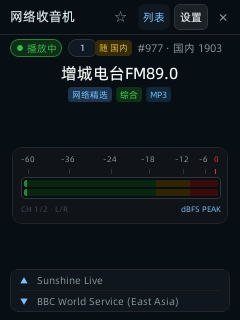
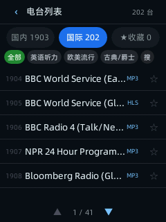

# 收音机（e6app 示例应用 · appid 8090906000000007）

网络收音机：基于 **SQLite 3 原生数据库**（`/userdisk/radio.db`）驱动的现代广播电台应用，收录 **2105 个高质量电台**，涵盖**全国 34 省市原版 1903 个国内电台**与 **Radio-Browser 全球精选 202 个外语名台（BBC/NPR/CNN/各类古典/爵士）**。

设备屏幕为 240×320；支持多维分类（国内三大专区、二级省市与题材胶囊筛选）、即时搜索、SQLite 分页流式加载、本地收藏持久化、手势切台、随机切台范围选择（国内/国际/全库/收藏）、双动效模式（随音乐律动/模拟动画），以及 9 种频谱样式与 5 套色彩方案。

---

## 界面预览

| 播放主页 (随音乐律动) | 国内电台 (5行防遮挡) | 国际听力专区 (202台) |
| :---: | :---: | :---: |
|  |  |  |
| 实时分贝峰值表 + 随机范围胶囊 | 三大专区 + 二级胶囊 + 格式徽标 | 外语分类 + BBC/NPR名台 |

| 省市多维筛选弹窗 | 收听设置 (双律动模式) | 模拟动画多频波峰 |
| :---: | :---: | :---: |
|  |  |  |
| 精确电台数量 + 毫秒级检索 | 随音乐律动 / 模拟动画矩阵预设 | HiFi 复合波律动算法 |

---

## 核心特性

1. **2105 电台完整数据库**：
   - **国内电台 (1903)**：100% 完整保留原版国内全部 1903 个电台，覆盖国家台及各省市自治区
   - **国际广播 & 英语听力 (202)**：BBC World Service, NPR News, CNN, Bloomberg, CBS, NHK World, RFI, Classic FM 等
   - **题材分类**：综合、新闻、音乐、交通、经济财经、文艺戏曲、都市生活、科技教育、古典、爵士等
2. **SQLite 3 原生驱动与串行防截断队列**：
   - 彻底移除了原先 1900+ 条内嵌 JS 数组，前端内存开销从几百 KB 降至几 KB；
   - 采用 Promise 串行队列调度 `process.exec('sqlite3')`，杜绝管道截断与 SyntaxError；
   - 毫秒级多条件复合检索、模糊搜索与即时分页。
3. **随机切台与范围选择**：
   - 支持 4 种随机漫游范围：**国内电台** (`cn`)、**国际广播** (`intl`)、**全库漫游** (`all`)、**我的收藏** (`fav`)；
   - 主界面顶栏直接显示模式胶囊（`随 国内` / `随 国际` / `随 全库`），轻触即可实时循环切换；
   - 设置页提供独立矩阵预设按键。
4. **双律动模式（随音乐律动 vs 模拟动画）**：
   - **随音乐律动**：由后台 `e6_sound_meter` 守护进程实时分析网络音频流 PCM，提取 16 频段能量驱动频谱与分贝电平表随着真实声音起伏；
   - **模拟动画**：采用多频复合波形叠加与动态鼓点节奏算法驱动，带来高保真视觉跳动。

## 操作

| 输入 | 动作 |
| :--- | :--- |
| **手势 左右滑** | 切台（切台自动开始播放） |
| **手势 点按频谱** | 停止 / 播放切换（双击切换动效样式） |
| 顶栏 **随 国内/国际** | 点击直接循环切换随机漫游范围 |
| 顶栏 **列表** | 打开电台库（支持国内 1903/国际 202/收藏、二级分类筛选、搜索） |
| 顶栏 **设置** | 打开收听设置（律动模式、随机切台范围、色彩方案、音量、睡眠定时） |
| 物理键 播放/暂停 | 停止 / 播放切换 |
| 物理键 上一首 / 下一首 | 切台 / 列表翻页 |

## 构建与运行

```bash
# 1. 重新构建电台数据库（可选，内置已有 assets/radio.db）
python3 tools/build_radio_db.py

# 2. 编译并部署运行
framework/bin/e6app build framework/examples/radio
framework/bin/e6app run   framework/examples/radio
```
